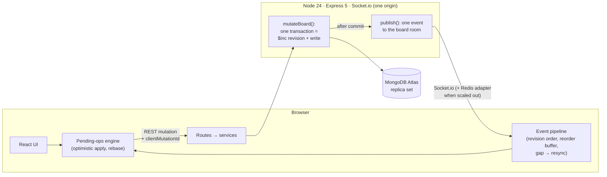

# SyncBoard

A real-time collaborative Kanban board. Several people drag cards, edit them, comment, and manage the board at the same time, and **every client converges to exactly what the database holds**: no lost edits, no silent overwrites, and automatic recovery from dropped connections and server restarts.

> **Live demo:** _not deployed yet_ · **Demo GIF:** _to be recorded_

## What it does

- Boards with lists and cards; drag and drop for both, including with the keyboard.
- Instant UI: every change shows up before the server answers, and rolls back cleanly (and only that change) if it fails.
- Live sync for every action, with presence ("who's here") and "Alice is editing…" indicators.
- Card descriptions in Markdown with autosave. Concurrent edits to **different** fields merge silently; edits to the **same** field show a conflict banner ("Use theirs / Keep mine / Copy mine"). Nothing is ever overwritten without the user choosing it.
- Members with owner / editor / viewer roles, board-level labels, comments, archive and restore, filters (text, member, label, due date) kept in the URL.
- Automatic resync after disconnects and server restarts, without a page reload.

## Architecture



The one rule everything hangs on: **one mutation → one transaction → one revision → one event.** Clients only change data over REST; the socket only announces committed changes, to everyone in the board's room including the sender. Each client applies events strictly in revision order, and reloads the board if a revision is missing for 500 ms.

A card move, end to end:

1. The drop applies the move locally right away (an *op* on top of the last confirmed card).
2. `PATCH /cards/:id/move` with the neighbors the user saw. The server places the card after the *current* successor of the card above (so two people dropping into the same gap get distinct positions), all in one transaction that also claims the board's next revision.
3. After the commit, `card:moved` goes to the whole room. Teammates apply it; the sender recognizes its own `clientMutationId`, and that confirms its op.
4. If the request fails, only that op is dropped and the card returns to its last *confirmed* state, which already includes everyone else's changes.

Full design: [docs/01-ARCHITECTURE](docs/01-ARCHITECTURE.md) · realtime protocol: [docs/04](docs/04-REALTIME-SOCKETS.md) · client engine: [docs/05](docs/05-FRONTEND.md).

## Design decisions and trade-offs

From the [decision log](docs/10-DECISION-LOG.md):

| Decision | Why | Cost |
|----------|-----|------|
| Server-authoritative realtime: writes over REST, socket only fans out (ADR-001) | Validation, auth, rate limits, and status codes stay in one place | Two channels to keep in step |
| Per-board revision, claimed **first** inside a transaction (ADR-004/010/015) | Clients can detect gaps and reorder; a crash can never commit a change that is never announced | Writes to one board are serialized (fine to ~100/s per board) |
| Fractional-index positions with successor-based neighbors (ADR-003/014) | A move writes one document; concurrent drops never collide | Occasional rebalance, carried in the same event |
| Pending-ops rebase model on the client (ADR-011/016) | Several in-flight changes on one card, plus teammates' edits, never clobber each other on rollback | ~150 lines of pure, heavily tested reducer logic |
| Compare-and-set only on title/description; last-write-wins for simple fields (ADR-005) | Toggling "done" never conflicts with someone's description edit | A 409 path the UI has to handle |
| Client-generated ObjectIds (ADR-012) | Optimistic creates need no temp ids; retries are idempotent | Server must reject ids owned by someone else |
| One origin for app and API (docs/06) | `SameSite=Lax` cookie, no CORS, no third-party-cookie problems | Client and API deploy together |

## Measured

On a 2,500-card board (5 lists × 500, `npm run seed -w server`) and with 50 live clients ([details](docs/08-TESTING-DEPLOYMENT.md#measured-phase-7-2026-11-06)):

| Measure | Result |
|---------|--------|
| Optimistic move, client store update | ~4 ms (the UI never waits for the network) |
| Components re-rendered by a card move | exactly 3 (source column, target column, the card) |
| Move → event at 50 other clients, server only (in-memory MongoDB, 10 moves/s) | p50 18 ms · p95 36 ms · 15,000/15,000 delivered |
| Same, against Atlas M0 from a home connection (4 moves/s) | p50 0.7 s · p95 4.5 s · 6,000/6,000 delivered |
| Board snapshot (2,500 cards), Atlas M0 | 982 KB · median 0.5–1.7 s across runs |

Against the free Atlas tier, latency is dominated by transaction round trips to the remote cluster; at 4 moves/s on a *single* board, requests queue behind each other (writes per board are serialized by design). No event was lost in any run.

## Run it locally

Requirements: Node 24, a MongoDB Atlas cluster (the free M0 tier works; transactions need a replica set).

```bash
npm install
cp server/.env.example server/.env      # set MONGO_URI, MONGO_DB=collabboard-dev, JWT_SECRET (64+ chars)
npm run dev                              # API :4000, app http://localhost:5180 (Vite proxies /api and /socket.io)
```

Optional: `npm run seed -w server` creates a 2,500-card board (log in as `seed-perf@syncboard.local` / `password123`; remove it with `npm run seed -w server -- --drop`).

## Tests

```bash
npm test          # unit + integration (shared, server, client); in-memory MongoDB, never touches Atlas
npm run e2e       # Playwright, two real browsers; builds the client, runs on an in-memory MongoDB
npm run lint
node load/propagation.js --base http://localhost:4100   # propagation load test (against `node e2e/server.js`)
```

The end-to-end suite covers two-user sync, the key cells of the [concurrency matrix](docs/11-FEATURE-WORKFLOWS.md#concurrency-matrix) (same-field conflict, different-field auto-merge, delete while open), recovery from a server restart, including a change whose event was lost, member removal, and the viewer role.

## Deploy

One container serves both the built client and the API (`Dockerfile`), so the browser sees one origin.

```bash
docker compose up --build                     # http://localhost:4000
docker compose --profile scale up --build     # 2 instances + Redis adapter + nginx (sticky) on :8080
```

Hosts with WebSocket support (Render, Railway, Fly.io) run the image as-is, with `MONGO_URI`, `MONGO_DB=collabboard-prod`, and `JWT_SECRET` set as secrets. See [docs/08](docs/08-TESTING-DEPLOYMENT.md#deployment-same-origin) for the production checklist. CI (`.github/workflows/ci.yml`) runs lint, all tests, the E2E suite, and `npm audit` on every push.

## Repository layout

```
client/   React 19 + Vite + Redux Toolkit (features/board: ops engine, event pipeline, UI)
server/   Express 5 + Socket.io + Mongoose 9 (services/mutateBoard.js is the heart)
shared/   event names, Zod schemas, position helpers, limits: used by both sides
e2e/      Playwright specs + the in-memory E2E server
load/     propagation load test
docs/     requirements, architecture, API, realtime protocol, ADRs, roadmap
```
